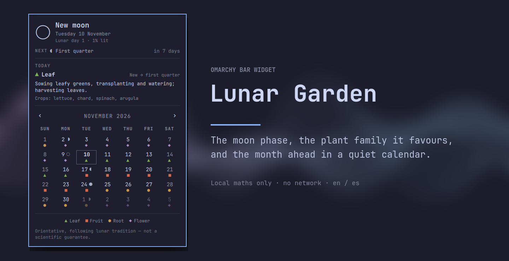

# Lunar Garden — Omarchy bar widget

Today's moon in the bar, the planting calendar on click. The phase that rules
the day, the plant family it favours, and the month ahead with its phase
changes and favourable days.

</img>

Built for Omarchy Quattro (`omarchy` 4.x). Pure phase maths in `Model.js`, no
dependencies and no network, so the whole model is testable without a running
shell.

## Install

```bash
omarchy plugin add https://github.com/na7hk3r/omarchy-lunar-garden --enable
```

`add` clones the plugin into your config directory and `--enable` puts the
widget in the bar. If it does not appear, rescan and read the log:

```bash
# Reload the shell so the new widget is picked up.
omarchy-shell shell rescanPlugins
# Check for load errors.
qs log -p "$OMARCHY_PATH/shell" --tail 50
```

The bar should now show the moon and today's family, e.g. `◑ ■`.

## Uninstall

```bash
# Out of the bar, files kept.
omarchy plugin disable nathker.lunar-garden

# Gone, checkout and all.
omarchy plugin remove nathker.lunar-garden
```

The only setting the widget writes is the hemisphere, and it lives in your own
`shell.json` layout entry, so removing the plugin leaves nothing behind.

## Using it

| Action | Result |
|--------|--------|
| Left click | Opens the planting calendar |
| Right click | Brings a browsing panel back to this month |
| `←` / `→` | Previous / next month |
| `↑` / `↓` | Previous / next year |
| Mouse wheel over the grid | Steps months |
| Click the month title | Back to today |
| `t` | Back to today |
| `[` / `]` | Previous / next month |
| `{` / `}` | Previous / next year |
| `Esc` | Close |

The grid never depends on the mouse: every month you can reach with the wheel
you can also reach with an arrow key, and the month title is a shortcut home —
it is labelled *Back to today* and returns the panel from any month.

### Settings

The widget accepts one option in its `shell.json` layout entry:

```json
{ "id": "nathker.lunar-garden", "hemisphere": "south" }
```

`north` (the default) draws the lit limb on the right while waxing. `south`
mirrors it, because the same lunar day is seen from the other side of the
equator. The panel and the bar pill read the same setting, so they never
disagree.

## The panel

- **Today** — the moon drawn at its current phase, the phase's name, the date,
  and the meta line: the lunar day and the lit percentage, e.g.
  *Lunar day 12 · 87% lit*.
- **Next** — the next of the four turning points, with its own glyph, its name
  and how many days away it is. The count rounds **up**, so "in 1 day" is
  always still ahead.
- **Today's work** — the family that rules the day, its window in the cycle,
  the tasks the tradition assigns it and the crops it covers.
- **The month** — a quiet seven-column grid: the date on every day, the family
  marker under it, and the phase glyph beside the date only on the four days
  the moon turns. Today is outlined with a hairline rather than filled,
  matching the native clock calendar; weekends are dimmed; the neighbouring
  months show at reduced opacity so the row keeps its seven slots.
- **Legend** — the four families in the order the moon turns.
- **Disclaimer** — one line, in the panel, so the reading never implies more
  authority than a tradition carries.

Colour and shape both name the family: the marker is geometric
(`▲ ■ ● ◆`) and tinted, so a colour-blind eye or a monochrome theme still reads
the day. The four families are:

| Marker | Family | Window |
|--------|--------|--------|
| `▲` | Leaf | new moon → first quarter |
| `■` | Fruit | first quarter → full moon |
| `●` | Root | full moon → last quarter |
| `◆` | Flower | last quarter → new moon |

Sizes go through `Style.space` and `Style.font`, so the panel follows the
theme's spacing and font scale exactly like the first-party panels. It is
anchored under the pill rather than centred on screen: the calendar belongs to
the widget that opened it.

## Languages

The panel and the bar tooltip follow the language picked under **Setup >
Language**, live, without a restart. Catalogues ship in `i18n/` as flat JSON,
one file per language code, wired through the shell's own
`Commons.Translations`:

```qml
Commons.Translations {
  id: strings
  directory: Qt.resolvedUrl("i18n")
}
```

A missing string falls back to its base language, then to `en.json`, then to
the key. English is the base and the fallback; Spanish ships complete.

The translation covers the phase names, the four families, their windows,
tasks and crops, and the chrome — not just the labels. Plurals are CLDR keys,
so English *in 1 day* / *in 3 days* and Spanish *en 1 día* / *en 3 días* both
read correctly instead of printing a number into a fixed sentence.

Adding a language is one file: copy `i18n/en.json`, translate the values, keep
the keys and the `%1`-style placeholders. `test/lunar-garden.test.js` fails if
a catalogue stops carrying the same keys, drops a placeholder or forgets a
phase or family the model can produce.

## Moon calculation notes

The model is a mean-cycle approximation, deliberately small and dependency
free:

- Synodic month: `29.530588853` days.
- Epoch: `2000-01-06T18:14Z`, a known new moon.
- Phase fraction: `((now - epoch) / synodic) mod 1`, so `0` is new, `0.25`
  first quarter, `0.5` full, `0.75` last quarter. A true modulo, not the
  remainder operator, so dates before the epoch stay in `0..1`.
- Illumination: `(1 - cos(2π · fraction)) / 2`, which is `0` at the new moon
  and `1` at the full one.
- Lunar day: `floor(fraction · 30) + 1`, the tradition's thirty-day count with
  day one beginning at the new moon itself.
- The eight named phases are bands of one eighth centred on those instants,
  which is also how the glyph set is quantized, so a name and its glyph can
  never disagree.
- The next change is the earliest future crossing of `0.25`, `0.5`, `0.75` or
  `1.0`, with the day count rounded **up** so "in 1 day" never means "already
  happened".
- The calendar samples each day at local noon, so a day is attributed to the
  family that holds at midday. DST, time zone and the local week start come
  from Qt's locale, never from a hard-coded offset.

`Model.js` is plain CommonJS with no QML dependency, which is what makes it
testable outside the shell and testable at all: the same file runs under `node`
and inside the shell with no build step and no copy of the model.

## Design decisions

- **Phase-quadrant model, not sidereal.** The family follows the four quarter
  boundaries rather than the moon's position against the constellations. It is
  the coarser, more common reading of the tradition, and it produces a stable
  four-way cycle a gardener can plan around.
- **Unicode Nerd Font glyphs, not bundled art.** The moon set is monochrome, so
  it inherits the theme's foreground and mirrors cleanly between hemispheres.
  The family markers are geometric for the same reason: shape is a second
  channel next to colour, never a decoration of it.
- **Pinned glyph font.** Nerd Font private-use codepoints are claimed by
  several fonts, so the glyphs are pinned to the family the theme actually
  resolved instead of letting Qt's fallback wander into, say, a CJK font's slot
  for the same code.
- **A quiet grid.** The moon appears only on the four days it turns; every other
  day keeps a single marker. Today is outlined rather than filled, and weekends
  are dimmed rather than coloured, so the grid stays a calendar and not a
  heatmap.
- **Date and glyph are one unit.** On change days the date and its moon are laid
  out as a pair, so the glyph never drifts toward the next column and never
  crowds a two-digit date in a narrow cell.
- **Everything scales.** Sizes go through `Style.space` / `Style.font`, so the
  panel follows the theme's spacing and font scale instead of pinning pixels.
- **No timers beyond a clock.** A minute-precision `SystemClock` exists only to
  notice midnight; the whole reading is recomputed from the date, not polled.

## Development

```bash
node test/lunar-garden.test.js
```

37 test cases over the astronomy, the phase bands and glyphs, the family
mapping, the boundary detection, the month grid, and the i18n catalog parity.
No test framework: the plugin ships no dependencies, and `node:assert` is
enough to pin the behaviour that matters.

`qmllint` is not on `PATH` on Arch, but it ships with Qt:

```bash
/usr/lib/qt6/bin/qmllint -I <import-path-for-qs> BarWidget.qml Panel.qml
```

`qs.Commons` and `qs.Ui` resolve from the shell config root at
`/usr/share/omarchy/shell`, so point an import path at a directory containing a
`qs` symlink to it.

## Files

| File | Role |
|------|------|
| `manifest.json` | Plugin manifest, schema version 1 |
| `BarWidget.qml` | Bar pill, midnight clock, IPC, panel host |
| `Panel.qml` | The planting calendar popup |
| `Model.js` | Astronomy and cultivation engine — phases, glyphs, families, next change, month grid — pure and tested |
| `i18n/` | String catalogues, one flat JSON per language (`en.json` is the base) |
| `test/lunar-garden.test.js` | Regression tests over the model (`node test/lunar-garden.test.js`) |

## Known limitations

- **Mean cycle, not ephemeris.** The approximation drifts by up to roughly
  0.6 day from the true instant of a phase over long spans. Fine for planning
  a sowing week, not for timing an eclipse.
- **Day precision.** A change that happens after local noon is attributed to
  the family that held at noon, so the day a boundary falls on can read as the
  outgoing family until the next midnight. The *Next* line still carries the
  exact phase.
- **Orientation, not guarantee.** The recommended tasks follow lunar-calendar
  tradition. They are a planning rhythm, not agronomic advice.
- **Nerd Font required.** The moon glyphs live in the Nerd Font private use
  area; the widget pins the themed family and falls back to
  `JetBrainsMono Nerd Font`.

## License

MIT — see [LICENSE](LICENSE). No bundled artwork, no third-party assets, no
subprocesses and no network access.
